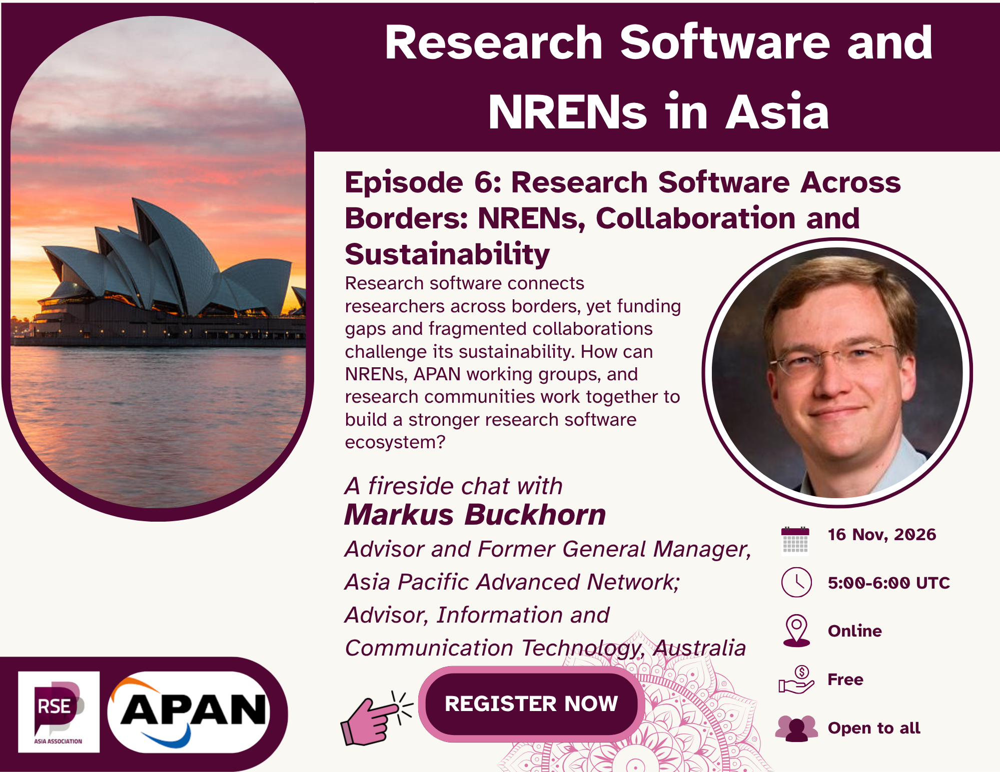

In the sixth and **final episode** of the **Research Software and NRENs in Asia** community conversation series, we will be joined by **Markus Buchhorn** to explore how research software, research infrastructure, and regional networks work together to support science across borders.

Drawing on his experience in research technology leadership and the Asia-Pacific Advanced Network (APAN), the conversation will explore software development practices, the importance of working groups within National Research and Education Networks (NRENs) and APAN, and the benefits of connecting these communities. We will also discuss strategies for funding and sustaining research software, and what research software practitioners can learn from wider research infrastructure collaborations.

This meetup is conversational in format, with no slides required. It is intended for researchers, research software engineers, librarians, infrastructure providers, and members of the broader open science community interested in the future of research support.

**16 November 2026 @ 5:00 – 6:00 UTC [(see in your local time)](https://www.timeanddate.com/worldclock/fixedtime.html?msg=Episode+6%3A+Research+Software+Across+Borders%3A+NRENs%2C+Collaboration+and+Sustainability&iso=20261116T05&p1=%3A&ah=1)**

<a class="rse rse-join" href="https://us06web.zoom.us/meeting/register/Loj0LjXOSB2XZYRIaS4TIA" target ="_blank"> _**Register now!**_</a>

## Invited Guest

- **[Markus Buchhorn](https://www.linkedin.com/in/markus-buchhorn/)**,
  APAN Advisor and former APAN General Manager, Australia

  Markus Buchhorn has extensive experience in research and education technology, research infrastructure, and international collaboration. His career has included roles as a university IT director at the Australian National University and a services director in an Australian e-research partnership. He served as General Manager of the [Asia-Pacific Advanced Network (APAN)](https://apan.net/) from October 2012 to March 2023 and continues to contribute as an APAN advisor.

  His work has connected the needs of research communities with technology planning, governance, and cross-institutional collaboration. He has also been involved in APAN working-group activities, including initiatives related to open and sharing data. In this conversation, we look forward to learning from his experience of connecting people, infrastructure, and ideas across the Asia-Pacific research ecosystem.

{}
### **Learn More About Us**

For more information and to join upcoming events, visit:

- Website: <https://rse-asia.github.io/RSE_Asia/>
- For the latest news, events, activities, and opportunities, follow us on our [LinkedIn page](https://www.linkedin.com/company/rse-asia-association/)
- To join the RSE Asia community, please fill out our short
[Community Membership Form](https://docs.google.com/forms/d/1XSxDaTJzcNyGeDYXyJNVg1TDCo7un18PLFNiK6_jL2g/edit)
{}
